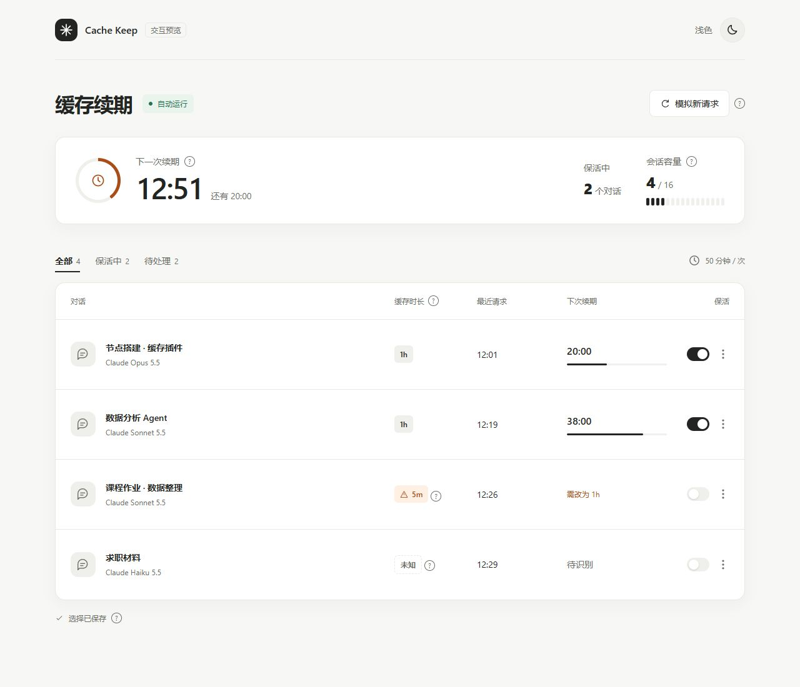
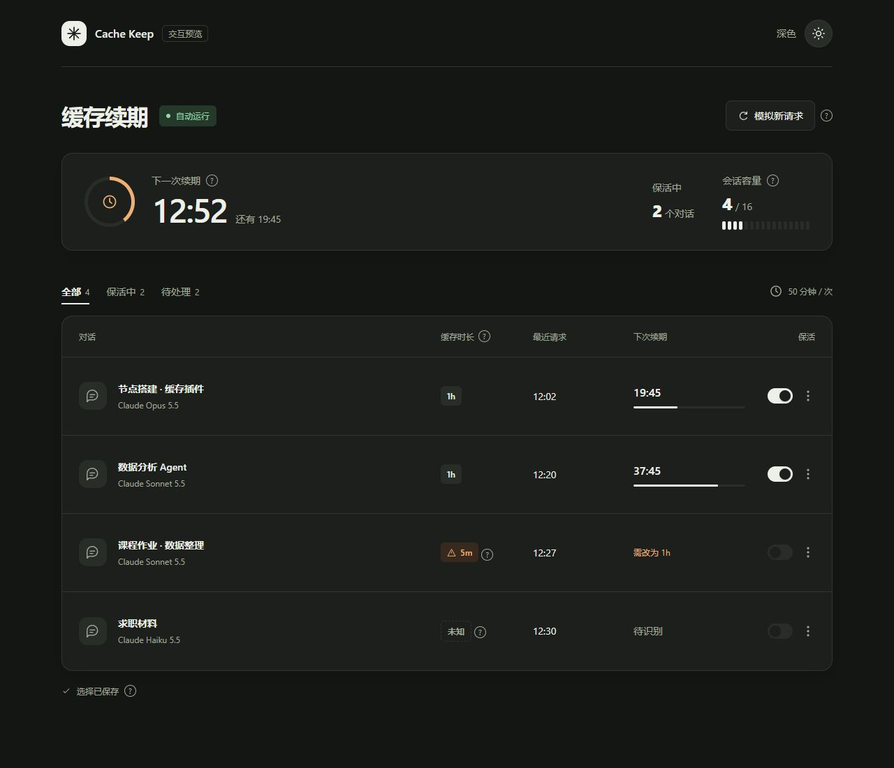
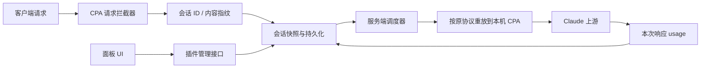

# CPA Cache Keep

为经过 CLIProxyAPI 的 Claude 对话自动续期 prompt cache。在面板中选择对话后，插件从最近一次普通请求或成功保活起算，默认空闲 50 分钟时重放该对话，生成上限为 1 token。对话继续产生请求时，计时自动顺延。

基于 [Banben07/cpa_claude_cache_keep](https://github.com/Banben07/cpa_claude_cache_keep) v0.8.12 开发，保留原项目 MIT 许可。插件 ID 沿用 `claude-cache-keepalive`，可以替换原动态库。



<details><summary>查看深色界面</summary>



</details>

截图使用演示会话。正式页面读取插件真实状态，支持明暗切换、对话筛选、重命名、开启／暂停和立即续期。说明、识别依据和缓存统计放在问号详情中。

## 实现原理

Claude prompt cache 会在成功读取后刷新有效期。插件通过 CPA 原有入口重放已保存的对话，请求携带相同的正文、工具定义和缓存相关参数，把输出上限设为 1，并关闭流式返回。这里的“最小请求”指最小生成量，完整缓存前缀仍需随请求发送。单独发送一句 ping 或调用 count_tokens 不能替代这一步。

默认续期时间为：

```text
下次续期 = max(最近普通请求时间, 最近成功保活时间) + 50 分钟
```

服务端每 5 秒检查到期会话。失败后不更新成功时间，1 分钟后重试；单个会话不会重叠保活。新请求会更新快照和计时。关闭浏览器后，服务器上的计时仍继续。

50 分钟策略适用于上游实际使用 1 小时缓存的情况。5 分钟缓存需要先在客户端或 CPA 中改为 1h；插件会显示提示，不自动改写原请求的缓存配置。改变 system、工具、thinking、effort 或账号路由都可能影响命中。接口时长与统计字段见 [Claude 官方缓存文档](https://platform.claude.com/docs/en/build-with-claude/prompt-caching)。

## 如何识别对话

优先读取客户端会话 ID：`Session_id`、`X-Session-Id`、`X-Codex-Session-Id`、`X-Claude-Code-Session-Id`，以及正文中的 `metadata.session_id` 或 JSON 格式 `metadata.user_id.session_id`。

没有会话 ID 时，用“模型名＋首条用户消息＋系统提示前 2048 字节”生成指纹。指纹方式可能合并相同开场的不同对话，也可能在压缩上下文、修改系统提示或切换模型后拆分同一对话。页面详情会注明识别方式。默认名称来自首条用户消息，可手动改名；插件不读取客户端侧栏中的聊天标题。

客户端、网关和协议转换层是否保留会话 ID，决定了实际归组效果。换用客户端或中转链路后，应分别发起两个对话，再在其中一个继续请求，检查列表归组和计时是否符合预期。

## 架构



| 模块 | 职责 |
| --- | --- |
| `main.go`、`management.go` | C ABI、插件注册、请求拦截、静态资源与认证管理路由分发 |
| `keepalive.go`、`sessions.go` | 请求筛选、会话归组、快照、时间与容量管理 |
| `renew.go`、`ping.go` | 协议路由、最小输出重放、响应验证、文件持久化 |
| `cache_ttl.go` | 解析请求声明的 1h、5m、混合或未知时长 |
| `ui_live.go`、`ui.html` | 状态序列化、静态页面和明暗主题；页面通过认证 API 获取状态 |
| `usage.go`、`settings.go` | 继承上游额度状态、暂停规则与配置持久化 |

Claude Messages、OpenAI Chat Completions 和 Responses 格式分别重放到本机 `/v1/messages`、`/v1/chat/completions` 和 `/v1/responses`。保留客户端请求的公开模型别名。这里只收录最终面向 Claude 的请求，不为 GPT、Gemini 等模型续期。兼容协议是否能命中，还取决于 CPA 的转换行为和上游路由。

## 缓存状态怎么看

页面上的 1h / 5m 来自已捕获请求的 `cache_control`；`ephemeral` 未写 `ttl` 时按 5m 标识。快照在 CPA 执行器转换之前捕获，执行器可能继续补充缓存参数，所以“未知”不等于上游没有缓存。

保活响应中的 `cache_read_input_tokens` 或兼容协议的 `cached_tokens` 用于确认本次读取量；`cache_creation_input_tokens` 表示写入量。如果响应提供 `cache_creation.ephemeral_1h_input_tokens` 和 `ephemeral_5m_input_tokens`，详情会列出按时长拆分的写入 token。读取总量没有时长拆分，不能据此声称“读取了 1h 缓存”。

连续两次大量缓存写入时，沿用原项目规则暂停该会话；新普通请求或手动续期可以恢复。上游额度达到暂停条件时，自动和手动保活都会暂停。默认不拦截普通聊天。

## 安装

发布覆盖 Darwin amd64/arm64、Linux amd64/arm64 和 Windows amd64。运行目标为启用原生插件支持的 CPA，动态库使用 `-buildmode=c-shared`。线上验证环境为 Linux amd64、CPA 8.0.59 和 Oh My CPA 0.3.23；其余平台通过原生运行环境的测试、编译和动态库加载检查验证。

1. 下载 [Release 中的 Linux amd64 ZIP](https://github.com/YHonc/cpa-cache-keep/releases/download/v0.11.0/claude-cache-keepalive_0.11.0_linux_amd64.zip)，对照同一 Release 的 [checksums.txt](https://github.com/YHonc/cpa-cache-keep/releases/download/v0.11.0/checksums.txt) 校验。ZIP 可供 CPA 插件商店安装器使用，也可解压后手动安装。
2. 停止 CPA，将动态库保存为 `plugins/linux/amd64/claude-cache-keepalive.so`。替换前备份旧动态库与配置。
3. 将 [配置示例](config.example.yaml) 合并到 CPA 配置，然后启动 CPA。
4. 正常请求经过 CPA 后，打开“缓存保活”资源页，开启目标对话的保活开关。

静态页面路径：

```text
/v0/resource/plugins/claude-cache-keepalive/status
```

Oh My CPA 代理路径：

```text
/api/v1/plugin-host/v0/resource/plugins/claude-cache-keepalive/status
```

resource 路由只提供编译时嵌入的静态页面，不注入会话状态，也不处理查询参数中的操作。动态接口位于 CPA Management Key 认证之后：

```text
GET  /v0/management/plugins/claude-cache-keepalive/state
POST /v0/management/plugins/claude-cache-keepalive/actions
```

POST 接收 JSON，例如 `{"action":"toggle","id":"会话ID","enabled":true}`。其他 action 为 forget、rename、ping 和 settings。GET 不执行修改。管理路由不设置 Menu，避免被宿主转换成公开 resource。

在 OMC 内，页面通过已登录会话的 plugin-host 代理访问管理接口。直接打开 CPA 静态页面时，需输入 Management Key；密钥仅保存在本页内存中。认证失败会停止自动请求，等待用户重新连接。反向代理可以继续提供额外访问限制，但插件不依赖它来保护动态接口。

## 配置与数据

| 字段 | 推荐值 | 作用 |
| --- | --- | --- |
| `interval_minutes` | 50 | 空闲续期间隔 |
| `max_sessions` | 16 | 保存会话数，上限 32；已开启会话不会被新会话挤掉 |
| `max_tokens` | 1 | 兼容配置字段；当前重放固定使用 1 token 输出上限 |
| `idle_evict_minutes` | 180 | 未开启会话的空闲淘汰时间，0 为关闭 |
| `guard_chat` | false | 关闭继承的普通聊天额度拦截 |
| `messages_url` | `http://127.0.0.1:8317/v1/messages` | 本机 CPA 地址，重放时按协议选择路径 |

名单、选择、时间与快照保存在 CPA 工作目录的 `claude-cache-keepalive.sessions.json`，Unix 写入权限为 0600；Windows 沿用工作目录的 NTFS ACL，应将工作目录放在受限的用户或服务目录中。快照含对话正文和重放所需的客户端认证头，应留在服务器，不能提交到 Git。页面状态接口不返回请求正文、请求头或 API Key。

重启后恢复持久化会话。旧版插件的内存快照不能直接迁移，首次替换后需产生一次新的正常请求，再勾选会话。回退时恢复旧动态库和配置并重启 CPA；保留状态文件即可在重新升级时恢复。

## 构建与测试

需要 Go 1.26+ 和 CGO 工具链。Linux 安装 GCC 与 libc 开发头文件后执行：

```sh
go test ./...
go test -race ./...
make build
```

输出为 `dist/linux/amd64/claude-cache-keepalive.so`。`ui.html` 通过 go:embed 编译进动态库，安装时不需要单独复制前端文件。

发布前打包：

```sh
python3 scripts/package-release.py --library dist/linux/amd64/claude-cache-keepalive.so --version 0.11.0
```

脚本通过 `--goos` 和 `--goarch` 指定目标，生成对应 ZIP 和 `checksums.txt`。`.github/workflows/release.yml` 在五种原生运行环境中运行单元、竞态与 ABI 加载检查，全部通过后一次发布五个 ZIP 和统一校验文件。ZIP 根目录包含对应动态库、LICENSE 和 NOTICE。

官方商店从 [CLIProxyAPI-Plugins-Store](https://github.com/router-for-me/CLIProxyAPI-Plugins-Store) 的 registry.json 读取目录。GitHub Topic 不会自动触发收录；登记 PR 合并后才会出现在官方源。后续更新按 `v<版本>` 发布新 Release，并附同版本 ZIP 与校验文件。

测试覆盖会话归组、已选会话保护、持久化、50 分钟到期调度、新请求顺延、失败重试、同会话互斥、三种协议的输出上限、TTL 解析和公开状态数据。调度测试通过构造时间验证，不等同于实等 50 分钟的上游缓存验收。部署验证记录见 [VALIDATION.md](VALIDATION.md)。

## 许可与来源

[MIT License](LICENSE)。原作 Copyright © 2026 Banben07；本项目修改 Copyright © 2026 YHonc。上游基线及依赖说明见 [NOTICE](NOTICE)。
